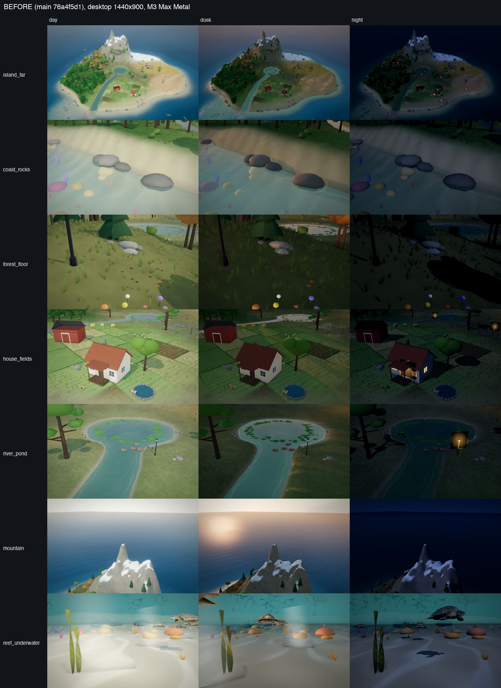
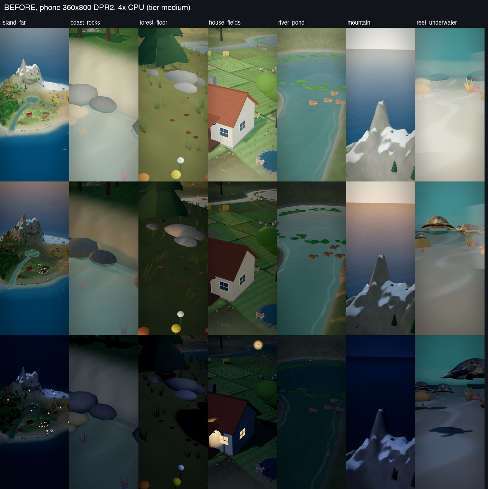
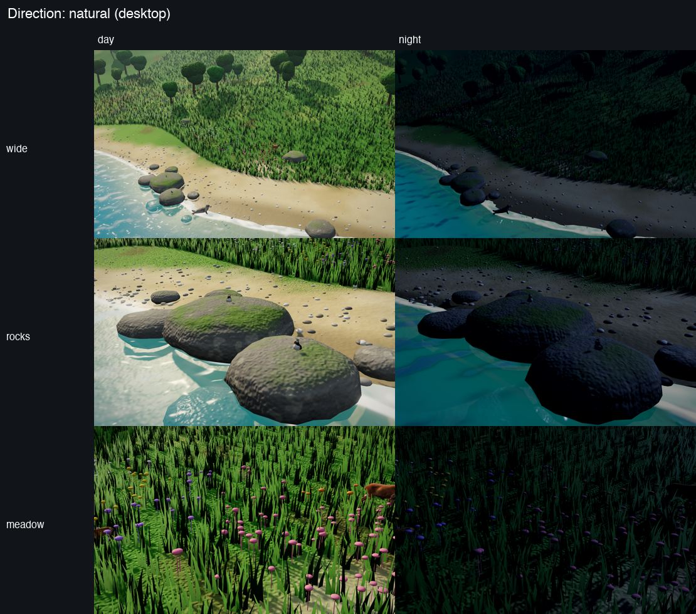
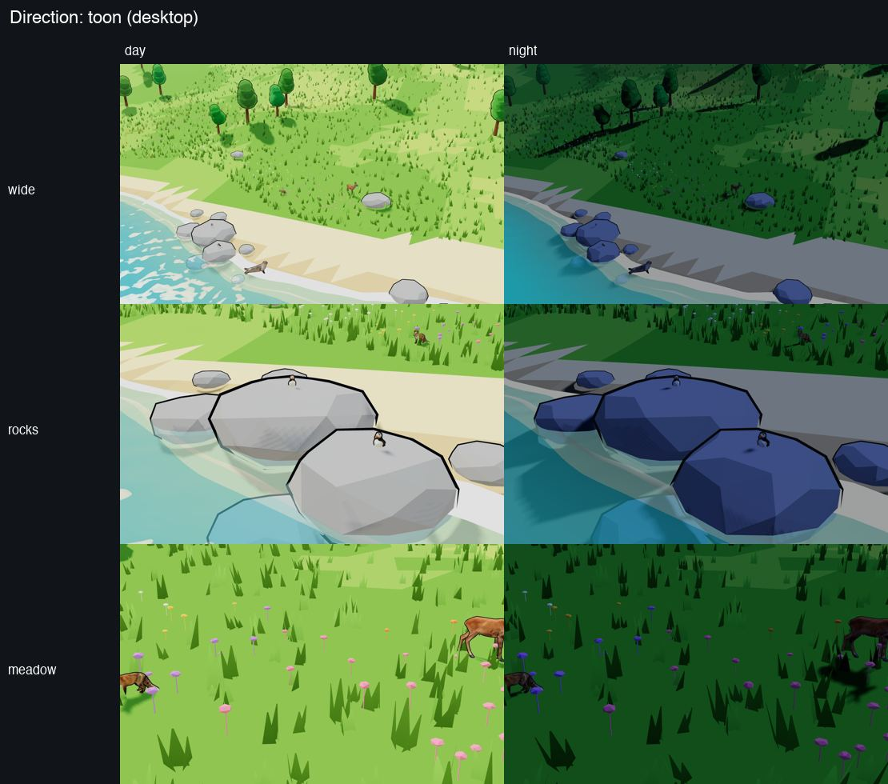
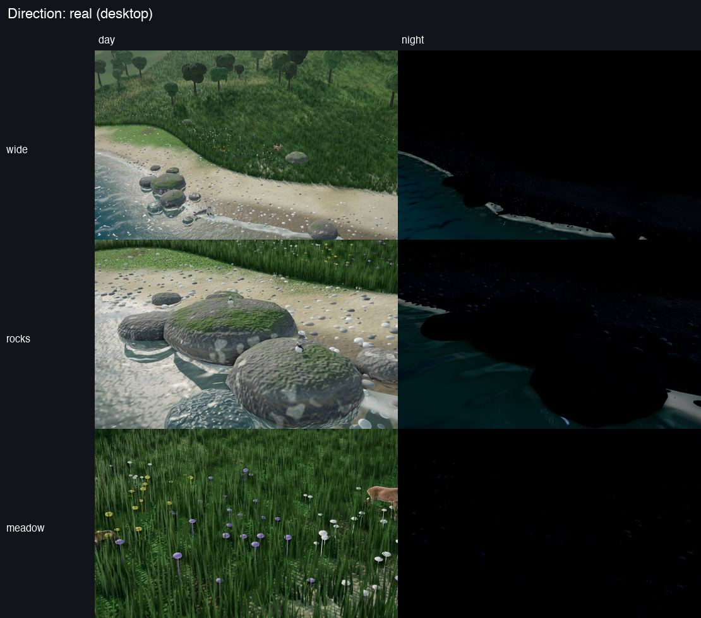

# Ark graphics pass, Step 1: art direction, golden shots, "before"

Branch `ark-graphics` (from origin/main 76a4f5d1). Visuals only: no server or ecology change.

**Status (2026-11-11):** the owner moved the pass forward the same day: "detailed, slightly stylised natural" is chosen, the review stops are skipped, and the batches go straight into the live scene on this branch. This page keeps the options and the "before" for reference.

## 1. Golden shots

Fixed views used for every before/after. Each is anchored to a **named place**, not to coordinates, so the shots survive the map rebuild (`docs/ark/map-plan.md`):

| Shot | Anchor (what the map is asked) | Framing |
|---|---|---|
| `island_far` | the scene's own home view | whole island |
| `coast_rocks` | the biggest cluster of waterline rocks nearest the beach (open shore, not a sea cliff) | 16 m, from the sea |
| `forest_floor` | the woodland's microhabitat corner (litter, stones, flowers) | 4.6 m, low |
| `house_fields` | the cottage, a third of the way to the farm fields | 27 m |
| `river_pond` | where the river leaves the lake, seen from downstream | 24 m |
| `mountain` | the highest ground round the mountains' site | 96 m, from the island's middle |
| `reef_underwater` | the coral reef's site, under the surface, level with the coral | 9 m |

Each in **day** (10.5 h, sun 41°), **dusk** (17.6 h, sun 6°) and **night** (22 h), on **desktop** and **phone**.

- Code: `src/ark-scene/golden-shots.ts` (the shots and a `GoldenWorld` interface: beach, shore rocks, forest floor, house, fields, lake, river, mountain area, reef), `src/ark-scene/golden-entry.ts` (the page, and the one adapter from today's map modules to `GoldenWorld`; the map build only updates that adapter).
- Harness: `node scripts/ark-golden-shots.mjs --label <name>` builds the page into `.ark-golden/` (gitignored), serves it on 127.0.0.1, drives Playwright's cached Chromium (`playwright-core`, Apache-2.0, already a dev dependency), and writes a PNG per shot plus `numbers.json` / `numbers.md`. It mounts the real scene on the v2 fixture (130 animals, 46 species) with every model preloaded, `recording: true` (no idle drift).
- Devices:
  - **desktop**: 1440×900, DPR 1, Metal GPU (M3 Max).
  - **phone**: 360×800 CSS px, DPR 2, touch, Android UA, 8 cores / 4 GB reported (the tier logic then picks `medium`, as on a mid-range Android), **4× CPU throttle**.
  - **GPU-limited proxy** (`--gpu swiftshader`): the same phone, with WebGL on SwiftShader (software rendering on the CPU). It is far slower than a real phone GPU, so its milliseconds are a **relative GPU-cost index** for before/after, not a phone frame rate. The Android emulator's Chrome renders on the host GPU, so it would not be GPU-limited either; not used.
- Numbers per shot: frame interval p50/p95 (vsync caps it at 16.7 ms), the scene's own CPU ms per frame, the GPU drain (ms waiting for the GPU to finish a frame, from a 1-pixel `readPixels`), draw calls, triangles, tier.

## 2. Before (main 76a4f5d1)

| Run | Frame interval p50 (median of 21 shots) | Worst p95 | Scene CPU ms (median) | GPU drain ms (median) | Draw calls | Triangles | Tier |
|---|---|---|---|---|---|---|---|
| desktop | 16.7 (60 fps) | 16.8 | 0.95 | 9.5 | 121–338 | 0.84–1.60 M | high |
| phone, 4× CPU | 16.7 (60 fps) | 16.8 | 2.86 | 2.8 | 49–156 | 0.41–0.66 M | medium |
| phone, SwiftShader proxy | 200 (5 fps) | 583 | 3.8 | 222 | 53–152 | 0.41–0.66 M | medium |

Full per-shot tables: `.ark-golden/shots/before*/numbers.md` (regenerate with the harness).

What the before shots show (matches the owner's notes):
- Ground: zone colour blobs from vertex colours at 1.3 m spacing; no texture detail up close (forest floor and beach are flat colour).
- Coast: grey low-poly lumps, flat milky shallows, no foam at the rocks, no pebbles.
- Mountain: a smooth cone with flat white patches; the sky behind is a pale band.
- Reef: flat white sand with rectangular shading seams.
- Night: readable at the house (windows already glow) but most of the island goes muddy; the forest floor is nearly black.
- Lighting: flat, the heavy vignette and tilt-shift blur the edges, fog washes the far side white.

Found on the way: the tier auto-drop ignores frame intervals over 250 ms (`index.ts`), so a device too slow for `medium` (5 fps) never drops to `low`.

## 3. Three art directions

The same slice (a beach with waterline rocks, a meadow rising to wooded hills, the Ark's own seal, puffins, roe deer and fox in it), built three ways in `src/ark-scene/study/art-study-scene.ts` (`golden.html?study=natural|toon|real`). All procedural, no downloads.

### A. Detailed, slightly stylised natural (chosen)

- Mood: *Alba: A Wildlife Adventure*, *Breath of the Wild* landscapes, Ghibli backgrounds: soft rich colour, lots of small detail, clear shapes from far away.
- Ground textures blended by height, slope and zone, with detail that grows as the camera comes close; depth-coloured water with clear shallows and foam; mossy rocks; dense wind-blown grass; flower drifts; pebbles.
- Fits the AI-made animal models: they read as part of the world, not pasted on.
- Assets: CC0 texture sets (Poly Haven, ambientCG), CC0 HDRI sky (Poly Haven), procedural rocks, grass, flowers and pebbles; optional CC0 models (Quaternius, Kenney) for props.
- Phone cost (study): 45–52 draw calls, 2.6 M triangles (grass dominates; LOD by distance brings it under 1 M), GPU drain 6–7 ms at phone size.
- Risk: grass and texture sampling are the cost; needs distance LOD and a low tier with fewer layers.

### B. Crisp storybook (toon)

- Mood: *A Short Hike*, Townscaper, Kenney / Quaternius nature kits: faceted low-poly, cel light, outlines, banded water.
- Cheapest (27–40 calls, 0.15 M triangles on phone, drain 2–4 ms), very readable.
- Risk: clashes with the photo-textured AI animals (they look stuck on), and nothing gains detail up close, which is the owner's main complaint.

### C. Naturalistic (photoreal-leaning)

- Mood: Planet Zoo, *Horizon*, nature documentaries: photographic palette, physical sky, image-based light, ambient occlusion.
- Heaviest (79–96 calls, 10 M triangles in the study, drain 7–11 ms on phone; needs GTAO and 4k shadows to hold up).
- Risk: the uncanny gap with AI-made animals is largest; night needs much more work; worst phone fit.

## 4. Recommendation

**A, detailed slightly stylised natural**, as the owner's default. The renders agree: it is the only one that improves the close-ups without making the animals look out of place, and its cost is controllable with LOD.
