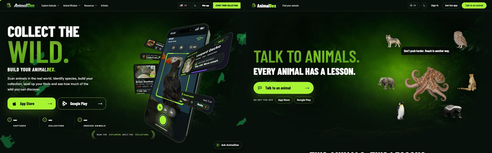
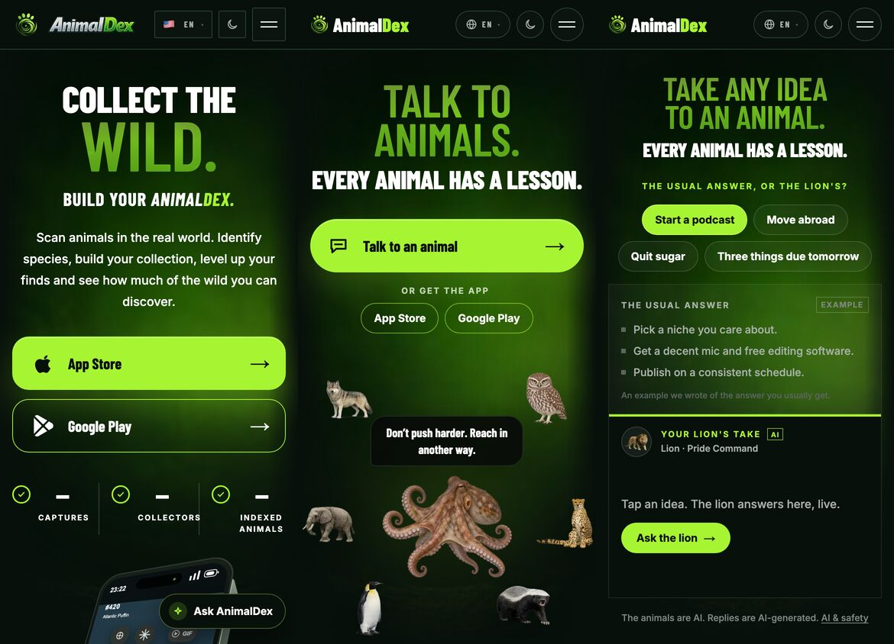
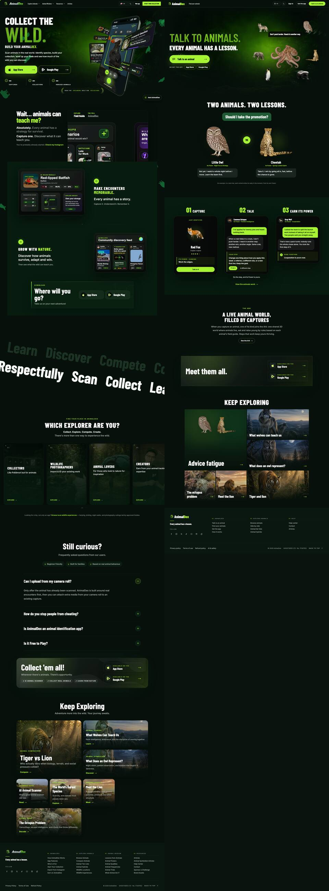

# SEO and positioning audit (lane S1, 2026-11-12)

Audited against production `https://animaldex.app` running landing main `970b0461`, the iOS app on `/Users/lennybeadle/AnimalDex` main, the Android app on `/Users/lennybeadle/AnimalDex-android` main, and the ASO package in `~/Documents/animaldex/app-store-3.1` (2026-10-24).

**The new positioning (owner, 2026-11-12)**

- Tagline: "Catch animals in real life and turn them into AI companions in a 3D world".
- AnimalDex is a living research world, not a gamified video game. It is a shared simulation of animal species where populations change over time through food chains and ecosystems. People understand nature from the animals' points of view and their stories, through the AI chat.
- Honesty: the world is built from each animal's field guide. Never call it scientifically accurate. Make no claims about population sizes or real-world science that the data doesn't support.

Sections: 1 Website positioning · 2 Design (old vs current) · 3 Technical SEO · 4 Keywords · 5 Apps and store listings · Decisions.

---

<!-- SECTION-1 -->

## 2. Design: the old landing (2026-10-13) against the current one

**Method.** The old landing is main `964f6b49` (2026-10-13 04:29 +0700, the last main commit on or before 2026-10-15). I ran it in a worktree with `next dev` and no environment variables, so its three live counters render as "—" (on production they showed real numbers). The current landing is production (`970b0461`), shot with `?hero=a` and `?hero=b` because the home page is running a 50/50 hero test (`src/lib/hero-variant.ts`). All shots are headless Chromium in dark mode: desktop 1440×900 at 1×, phone 390×844 at 2×.

| | |
|---|---|
| Desktop, first screen: old (left) and current hero A (right) |  |
| Phone, first screen: old, current A, current B |  |
| Desktop, whole page at the same scale: old (left, 7,793 px) and current A (right, 4,842 px) |  |

Single shots: `seo-audit/old-2026-10-13-home-desktop-fold.jpg`, `seo-audit/current-home-hero-a-desktop-fold.jpg`, `seo-audit/current-home-hero-b-desktop-fold.jpg`, `seo-audit/old-2026-10-13-home-mobile-full.jpg`, `seo-audit/current-home-hero-a-mobile-full.jpg`.

### 2.1 What made the old one feel crafted

1. **The product was the hero image.** The right half of the hero was a real 3D CSS phone: a chassis with a modelled side edge (`rotateY(90deg) translateZ(...)`), turned by scroll progress (`rotateY(-20 - p·10) rotateX(8 + p·6) rotateZ(8)`), with the real capture camera on screen (an Atlantic Puffin, the 1x/2x/5x zoom, the shutter). Five real UI cards floated around it at different depths: Field guide · Leopard Gecko, AI analysis · British Shorthair, Catalog, Pack builder, Scenario result (old `src/app/[locale]/(composited)/(home)/page.tsx` lines 398–416 and `_components/phone.tsx`). You could see what the app is before reading a word. The current hero shows cut-out species art floating on a glow, or two text boxes. Neither shows the app, the card or the 3D world.
2. **A typographic hierarchy with four distinct levels and a second voice.** In the old hero, "COLLECT THE" (5.5rem) sat over a huge photo-textured "WILD." (up to 11.5rem, `leading-[0.78]`), then "BUILD YOUR *ANIMAL**DEX*." in the **italic** condensed face, then a plain sentence-case paragraph in Inter at 18px (old page.tsx lines 317–333). The italic gave the brand a second voice. All eight italic faces were removed on 2026-11-01 (`src/app/fonts.ts` lines 17–31 now say "No 400 face or any italic is preloaded"), so every heading on the current page is the same upright, uppercase, condensed extrabold. "TALK TO ANIMALS. / EVERY ANIMAL HAS A LESSON." are two lines in one register at two sizes, and nothing on the first screen is a sentence a reader can parse.
3. **A brand mark with character.** The header used the chrome italic **AnimalDex** wordmark (the bevelled, slanted logo from the app icon family). Commit `bb019736` (2026-11-01) retired it for a flat lockup in Barlow Condensed 800 ("the chrome wordmark is retired from the UI"). The flat lockup is a font set in two colours. It is the single largest loss of brand distinctiveness, visible on every page.
4. **Brand ornament used with restraint.** There was a laurel-wreath seal under the hero ("MADE FOR EXPLORERS. BUILT FOR COLLECTORS.", lines 418–436), a scatter of dark-green animal silhouettes across the hero background (the icon canvas), and a custom cursor. A tilted, two-row kinetic marquee (Learn · Discover · Compete · Respectfully · Scan · Collect) worked as a section break. These are small pieces that only this brand has.
5. **Dense, realistic information design inside the mock-ups.** The "AI SCAN RESULT" card for the Red-lipped Batfish had a conservation chip, tier, confidence 99.8%, rarity 54%, DOM/SPD/INT stat bars, a common-region mini-map (Galápagos, Ecuador, Seafloor) and an Applied insight tile. The "Community discovery feed" had three real user cards. That density reads as a real, deep product. The current stills (Capture, Talk, Earn its Power) are clean but sparse: one animal, one line and one button each.
6. **People in the imagery.** The "Which explorer are you?" row used real photography of people (a photographer, an animal lover, a creator) over numbered cards (01–04). The current page has no human in it.
7. **The Keep exploring cards had editorial structure.** Each card had an eyebrow category (ANIMAL COMPARISON, ANIMAL POWERS, SCANNER GUIDE, RARE ANIMALS, SPECIES PROFILE, ANIMAL MIND), a title, a one-line dek and a verb CTA (Compare →, Learn →, Decode →), with rounded corners and varied sizes. Now it is title only (`page.tsx` lines 152–162 note "Pictures and a title only (2026-11-01)"), with a gradient fade and square tiles 1px apart.
8. **More section rhythm.** It alternated left-aligned text beside a big mock (Wait… animals can teach me? / Make encounters memorable / Grow with nature), then a full-bleed band, then the marquee, then cards, then the FAQ. The current page stacks the same centred uppercase H2 over centred content five times.
9. **A richer footer.** It had four numbered columns (01 AnimalDex, 02 Explore animals, 03 Animal wisdom, 04 Resources) with 26 links. Now there are three columns and 13 links. That is a craft signal, and an SEO one too (see 3.7).

**What not to bring back.** The old copy was the game positioning the owner now rejects: "Collect the Wild.", "Collect 'em all!", "Like Pokémon but for animals" (old `src/data/locales/en.json` lines 80, 209, 166), "Compete", battle "Scenario result · won 3 cr", tier letters, and "BREEDING EST. PRICE £350 – £900" on a cat card. Bring back the craft, not the words.

### 2.2 What makes the current one feel generic ("vibe-coded")

1. **A default AI-landing hero.** It is a centred radial neon glow behind a blurred jungle photo, a giant uppercase two-line slogan, one pill CTA with an arrow glyph, and two ghost pills ("App Store", "Google Play" as plain text with no store marks; `page.tsx` lines 262–280). It is the same composition as thousands of generated landing pages.
2. **Floating cut-outs with no ground, scale or light.** In hero A, seven species icons orbit a centre octopus (`HomeAnimalOrbit`). An elephant is smaller than an owl, nothing casts a consistent shadow, and the art style (soft, airbrushed, isolated on transparency) reads as stock AI clip art next to the real photo behind it. The speech bubble "Don't push harder. Reach in another way." is a black rectangle in the display face.
3. **Hero B is a chat-SaaS template.** It has a chip row of example prompts ("Start a podcast", "Move abroad", "Quit sugar", "Three things due tomorrow"), then a two-column "THE USUAL ANSWER / YOUR LION'S TAKE" comparison box with an "EXAMPLE" tag and an "AI" tag. Nothing in it is about animals, nature or a world. It could be any AI-assistant landing page.
4. **Gradient and glow defaults everywhere they appear.** The download band is `bg-[radial-gradient(circle_at_20%_0%,rgba(167,244,50,0.16)…),radial-gradient(circle_at_100%_100%…),linear-gradient(135deg…)]` with a `blur-3xl` animated `ctaGlow` blob behind it (`page.tsx` lines 462–463). The bento's lead card is two cut-outs on another radial gradient (line 545), so it reads as a placeholder for a missing image. The tiles fade to black with `bg-gradient-to-t from-canvas-950`. These are Tailwind defaults with nothing done to them.
5. **One type register for everything.** Every H2 is `font-display font-black uppercase` at 4–6rem, centred ("TWO ANIMALS. TWO LESSONS.", "A LIVE ANIMAL WORLD, FILLED BY CAPTURES", "KEEP EXPLORING", `page.tsx` line 261 `sectionTitle`). There are no eyebrows on most sections, no deks, and body copy at 14–16px in grey. Shouting at one volume reads as a template.
6. **Text-glyph arrows and inline-SVG chat icons as the icon system.** There are "→" characters in seven places on the page, and the hero's chat bubble icon is a hand-drawn 2-path SVG (lines 329–332). No icon family, nothing branded.
7. **The Ark, the thing the new positioning is about, has no picture.** "A live animal world, filled by captures" is an eyebrow, a heading, a paragraph and a ghost button (`page.tsx` lines 449–457). The single most visual product AnimalDex has (a 3D world with two islands and real players' animals) is shown as text.
8. **Square, hairline-gapped tiles.** The bento has `gap-1` and `rounded-[2px]` store buttons, beside pill buttons and rounded chat stills. Three corner languages on one page read as no system.
9. **Short and thin.** The page is 4,842 px against the old 7,793 px. Three of its eight blocks are a heading plus one element. Fewer sections are fine, but each remaining one carries less.

### 2.3 Recommendations for the landing redesign (S2)

- **Make the hero the product again, now the 3D world.** Use a real render or capture of `/ark` (an island with real players' animals), with a real capture card and a real chat line from that animal layered at depth, the way the old phone and cards were. A slow parallax or a short muted loop works too. Those three things are the new tagline: catch → companion → 3D world.
- **Bring back the brand mark.** Restore the chrome italic wordmark in the header (the file is still in the repo, per `bb019736`) or commission a proper flat redraw of it. Restore one italic face, 700 or 800 italic only, as the brand's second voice.
- **Use a four-level type scale:** an eyebrow (11–12px, tracked caps, neon), a display headline, a sentence-case dek in Inter at 18–20px, and body. Give the first screen one plain sentence that says what the app is.
- **One corner radius, one icon set, real store badges.** Pick a radius (the chat stills' radius is the natural one) and use it for tiles, bands and buttons. Use Apple's and Google's official badges instead of text pills.
- **Use field-guide craft as the visual language:** a specimen label, a scientific name in italic, a habitat line, a small range map, a population-trend sparkline from the Ark. It suits "a living research world built from field guides" and brings back the old scan card's density without game stats.
- **Put people and real places back:** real user captures from the feed (with permission and public-only, the way the old discovery feed did) and the trip footage.
- **Keep what the current page does well:** the real photo texture in the hero word, the restrained palette, a light page (about 0.8–0.9 MB, zero layout shift in the before run, see 3.9), and no stats or laurel for their own sake. Any 3D or video hero must be a poster image first, with the live scene loaded after LCP, or it will cost what `/ark` costs (see 3.9).

<!-- SECTION-3 -->
